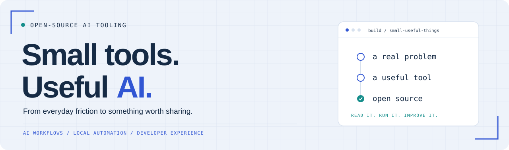

  <b>AI 工具 · 工作流自动化 · 开发者体验</b> 
  Practical tools for everyday development.

## 把真实问题，做成可复用的工具

这里展示 AI 教育中台、教学实训与脑机接口平台，并分享围绕 AI 辅助开发、本地自动化和开发者体验的开源工具。平台展示仓库提供介绍与演示资料；工具仓库按各自许可证发布。

### 开源作品 / Featured project

#### [Codex 本地项目同步 ↗](https://github.com/throwOctober/codex-local-project-sync)

切换 Codex 账号后，在本机核验并恢复已有项目登记，便于继续原来的工作。工具包含只读预检和写入前备份，适用于项目说明中列出的 macOS 应用版本。

`Python` · `macOS` · `Local-first` · `MIT`

[查看源码 →](https://github.com/throwOctober/codex-local-project-sync) &nbsp; · &nbsp; [使用说明](https://github.com/throwOctober/codex-local-project-sync#readme) &nbsp; · &nbsp; [Gitee 镜像](https://gitee.com/yifeiyin/codex-local-project-sync)

### 项目展示 / Project showcases

以下三个平台仓库提供项目介绍、公开版 PPT、PDF 和预览图，不提供应用源码。

| 项目 | 方向 | 展示入口 |
| --- | --- | --- |
| AI Hub Platform | 课程资料驱动备课与答疑，教学内容可审改、引用与评阅可回查 | [GitHub](https://github.com/throwOctober/ai-hub-platform-showcase) · [Gitee](https://gitee.com/yifeiyin/ai-hub-platform-showcase) |
| 智训云平台 | 指导书与操作环境进入课时任务，依据步骤检查开展实训辅导 | [GitHub](https://github.com/throwOctober/zhixun-cloud-showcase) · [Gitee](https://gitee.com/yifeiyin/zhixun-cloud-showcase) |
| SynapseX | 个人基线反馈连接 Blockly/Python、3D 场景与目标闯关 | [GitHub](https://github.com/throwOctober/synapsex-bci-showcase) · [Gitee](https://gitee.com/yifeiyin/synapsex-bci-showcase) |

### 关注方向 / Focus

| AI 辅助开发 | 本地自动化 | 开发者体验 |
| --- | --- | --- |
| 把需求、实现与验证整理成可重复的工作流。 | 减少重复操作，让小工具处理具体问题。 | 清晰的使用说明、可复现的问题与可检查的结果。 |

### 一起改进 / Collaborate

发现问题、提出建议或交流使用场景，欢迎通过 [GitHub Issues](https://github.com/throwOctober/codex-local-project-sync/issues) 讨论；有改进方案，也欢迎提交 [Pull Request](https://github.com/throwOctober/codex-local-project-sync/pulls)。

Build something small. Make it useful. Share it openly.

